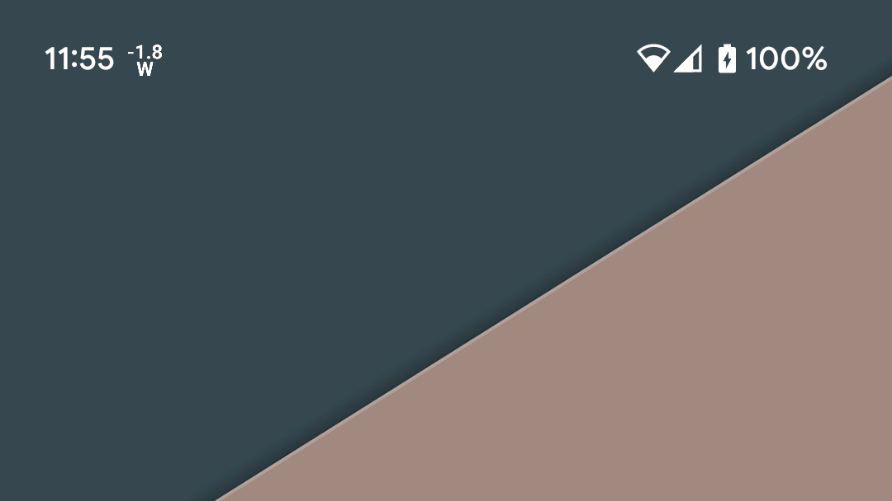
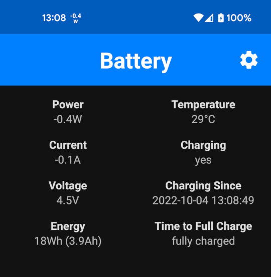
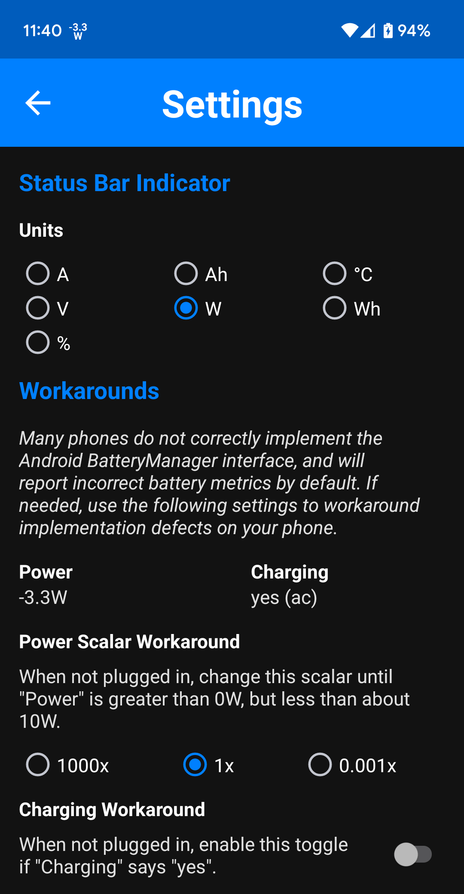

# Wattz

Note: Due to the unreasonable requirements and burden of shipping an app on Google's
Play store, Wattz is no longer available there. It can still be installed via
F-Droid.

*Wattz* is a simple battery indicator. It shows one of several real time battery
metrics right in your status bar. Open the app to see detailed battery metrics
and and edit your settings.

Notification permissions are required to show the indicator in the status bar.
Please open the app once to automatically start the indicator service.

This app respects your privacy!
* No unnecessary permissions
* No ads
* No collection of user data of any kind
* No sharing data with third parties

Detailed battery metrics include:
* Power (watts)
* Current (amps)
* Voltage (volts)
* Energy Level (watt-hours and amp-hours)
* Temperature (celsius)
* Charge Level (percent)
* Is Charging (yes/no)
* Charging Since (date/time)
* Time to Full Charge (duration)

## Screenshots

**Status Bar**

**App View**

**Settings View**

## FAQ

1. Why does my phone always show `0W`?

    Many phones, especially Samsungs, don't follow the BatteryManager spec. Try changing "Power Scalar Workaround" in the settings view.

2. Why does my external power meter show different power numbers than *Wattz*?

    *Wattz* can only measure power coming into or out of the battery management system. In addition to this amount, your external meter is also measuring any power your phone is actively using at the time.

3. Why isn't the indicator showing up in my status bar?

    *Wattz* needs notification permissions on newer Android phones in order to show the indicator. Make sure to open *Wattz* at least once, where it should prompt you to grant it permissions. Otherwise, check the Android app settings to ensure *Wattz* has notification permissions.

   Keep in mind, Android can revoke these permissions at any time without telling you, so you may need to re-enable them periodically.

4. Why does *Wattz* show a negative number while charging?

    *Wattz* is a power consumption indicator, so positive values are associated with power being consumed. Charging, effectively the oposite, is thus negative. While many people successfuly use *Wattz* as a charging indicator, this was not its original purpose.
